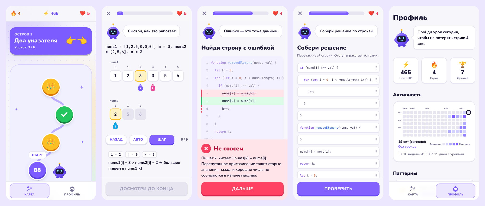

# AlgoQuest

Тренажёр алгоритмов для собеседований в формате коротких игровых уроков: карта пути, XP, стрики, сердечки, маскот Бит и анимированные визуализации алгоритмов. Учим **паттерны** (два указателя, подсчёт и словари), а не отдельные задачи: остров на карте — паттерн, урок — задача из LeetCode Top Interview 150.

**Демо:** https://algoquest-rosy.vercel.app



## Что умеет

- **Mobile-first, без клавиатуры.** Всё решается тапами и перетаскиванием на экране 375px: выбор ответа, плитки в пропуск кода, тап по строке с багом, сборка решения из строк (dnd-kit: палец, мышь, клавиатура).
- **7 типов упражнений:** теория, пошаговая визуализация, выбор ответа, «что вернёт функция», заполнение пропуска, сборка решения, поиск бага.
- **Визуализатор алгоритмов:** ячейки массива или строки, указатели-стрелки, которые плавно переезжают, подсветка сравнения и записи, второй ряд для задач с двумя массивами (Merge Sorted Array).
- **Движок урока как в языковых приложениях:** ошибка забирает сердечко и отправляет упражнение в конец очереди; итог с XP, точностью, временем и карточкой «Как рассказать на собесе».
- **Прогресс без бэкенда:** XP, стрик, календарь активности как на GitHub, сердечки с восстановлением — всё в `localStorage`.
- **Тёмная тема** (система / светлая / тёмная) без вспышки при загрузке, `prefers-reduced-motion` отключает анимации.

## Стек

Next.js 16 (App Router, Cache Components) · React 19 · TypeScript strict · Tailwind CSS v4 · Framer Motion · Zustand · zod · dnd-kit · prism-react-renderer · Vitest · Vercel

## Архитектура

- **Контент — данные, а не код.** Уроки лежат в `src/content/islands/*.ts` и при сборке проходят zod-схему: опечатка в индексе ответа или указатель за границей массива роняют `next build`, а не прод.
- **Контент проверяется исполнением.** Тест `src/content/solutions.test.ts` запускает код из упражнений на тест-кейсах: собранное решение (и каждый допустимый порядок строк) должно проходить, а код из «найди баг» — проходить с исправлением и падать без него. Зависший код останавливает счётчик итераций.
- **Логика отдельно от UI.** Движок урока (очередь, фазы, сердечки), стрик, восстановление сердечек, календарь — чистые функции в `src/lib` с тестами. Компоненты только отображают состояние.
- **Шаги визуализаций** сгенерированы прогоном самих алгоритмов, поэтому совпадают с тем, что вернёт решение.

```
src/app/            маршруты: карта, урок, профиль, витрина /dev/ui
src/components/     ui, map, lesson, viz, profile, mascot
src/content/        острова и уроки (данные) + тесты решений
src/lib/engine/     движок урока, проверка ответов, порядок строк
src/lib/progress/   XP, стрик, сердечки, календарь
src/store/          Zustand: прогресс, настройки, заходы в урок
```

Подробные договорённости для разработки — в [CLAUDE.md](CLAUDE.md), исходное ТЗ — в [SPEC.md](SPEC.md).

## Запуск

```bash
npm install
npm run dev         # http://localhost:3000
npm test            # Vitest: движок, прогресс, контент
npm run lint
npm run typecheck
npm run build
```
